# Awami Kam (عوامی کام) — Pakistan's AI Voice-First Daily-Wage Marketplace

> **"عوامی کام — چوک کی لمبی قطاروں سے نجات"**  
> *Freedom from street-corner Chowk queues. Empowering daily-wage artisans and homeowners through voice-first AI matching and fair wage protection.*

---

## 👨‍💻 Developed By
**Sole Full-Stack Developer**: Built entirely by **Muzainah Faisal** as a complete end-to-end production solution for blue-collar empowerment.

---

## 📋 Table of Contents
1. [Problem Statement](#problem-statement)
2. [Solution & Key Features](#solution--key-features)
3. [Tech Stack](#tech-stack)
4. [Setup & Installation](#setup--installation)
5. [AI Methodology & Model/API Usage](#ai-methodology--modelapi-usage)
6. [App Screenshots Gallery](#app-screenshots-gallery)
7. [Git Commits & Version Control](#git-commits--version-control)

---

## 1. Problem Statement
In major Pakistani cities (Karachi, Lahore, Islamabad, Faisalabad), millions of daily-wage laborers (painters, plumbers, electricians, masons) spend hours every morning standing at physical street corners (**Chowks**). 
- **For Workers**: Loss of productive hours, exploitation by middlemen, lack of price transparency, payment uncertainty, and digital illiteracy barriers.
- **For Hirers**: Inability to verify worker background, risk of subpar workmanship, lack of fair wage benchmarks, and friction in finding trusted local artisans quickly.

---

## 2. Solution & Key Features
**Awami Kam** bridges this gap with a production-grade, mobile-first web application designed specifically for low-literacy users and modern homeowners:
- **100% Voice-First Interface**: Workers and hirers can speak naturally in regional languages (**Urdu, Punjabi, Pashto, Sindhi, English**). No typing or reading required.
- **AI Fair Wage Engine**: Automatically detects sub-market or exploitative wage offers, warns hirers/workers, and protects fair compensation based on real-time regional benchmarks.
- **Worker Location Customization**: Workers can select their preferred work areas anywhere in the city (e.g., Gulshan, Clifton, DHA, Saddar, Nazimabad) to receive targeted job requests.
- **Instant GPS Matching**: Ranks available workers by skill match, proximity, reliability score, and availability within seconds.
- **Behavior Feedback & Rating Exchange**: Post-job rating and review exchange where both hirers and workers evaluate each other's behavior and reliability.
- **Privacy-Preserving Contact**: Secure phone masking with direct call options.

---

## 3. Tech Stack
- **Frontend**: React 19, TypeScript, Tailwind CSS v4, Lucide Icons, Vite.
- **Backend & Database**: Supabase (PostgreSQL, Row Level Security, Realtime Subscriptions, Auth).
- **AI / Voice Services**: Google Gemini API (`@google/genai`) for multimodal job parsing, fair wage calculation, scam detection, and voice transcription; browser Web Speech API & audio synthesis.
- **State & Storage**: LocalStorage fallback for offline resilience, IndexedDB caching.

---

## 4. Setup & Installation

To run the project locally on your machine (Laptop, Tablet, or Mobile emulator):

1. **Clone or Download Repository**:
   ```bash
   git clone https://github.com/Muzainah07/Awami-Kaam-.git
   cd awami-kam
   ```

2. **Install Dependencies**:
   ```bash
   npm install
   ```

3. **Start Development Server**:
   ```bash
   npm run dev
   ```

4. **Open in Browser**:
   Navigate to **`http://localhost:3000`** (fully responsive across iOS, Android, tablets, and desktop laptops).

---

## 5. AI Methodology & Model/API Usage

Awami Kam integrates advanced AI models to simplify blue-collar hiring:
- **Multimodal Voice & Text Parsing**: Converts spoken Urdu/regional dialects into structured job parameters (skill required, area, square footage, urgency, offered rate).
- **Fair Wage Benchmarking**: Analyzes local market rates per task unit (e.g., PKR per room painting or plumbing point) to flag unfair bids.
- **Real-Time Sentiment Analysis**: Analyzes voice reviews and post-job feedback to maintain platform trust and safety scores.

---

## 6. App Screenshots Gallery

Here are screenshots of the Awami Kam platform across various views and user flows:

### Welcome & Onboarding
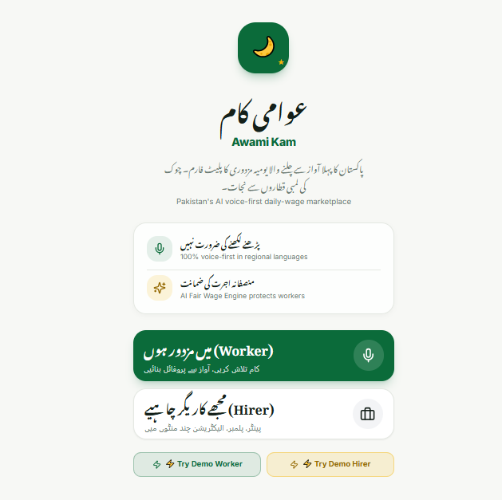

### Hirer Portal & Booking Workflow
| Overview | Step 1 | Step 2 |
|:---:|:---:|:---:|
| 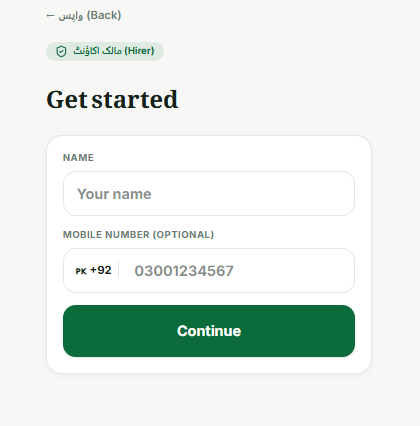 | 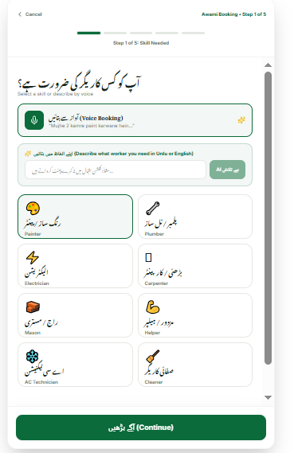 | 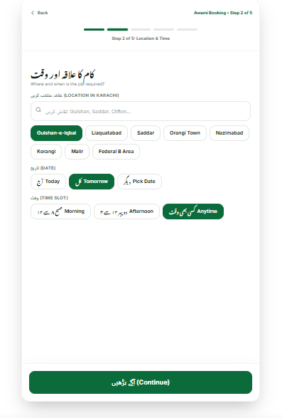 |

| Step 3 | Step 4 | Step 5 |
|:---:|:---:|:---:|
| 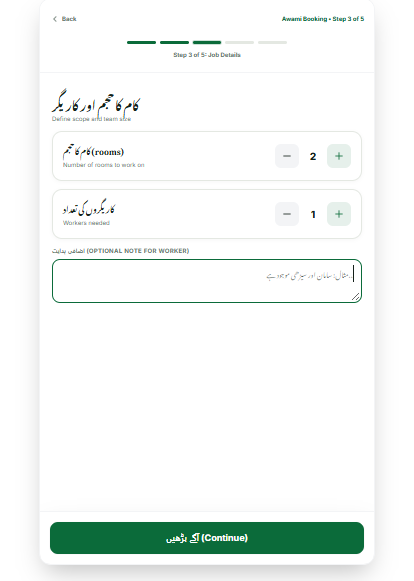 |  | 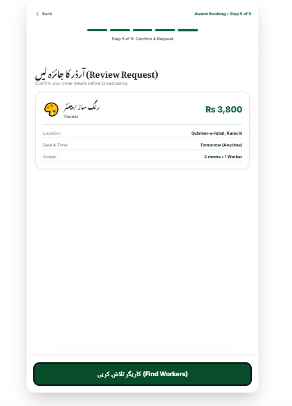 |

| Step 6 | Step 7 | Step 8 |
|:---:|:---:|:---:|
| 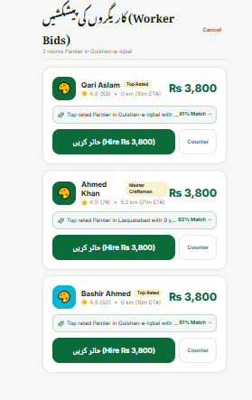 | 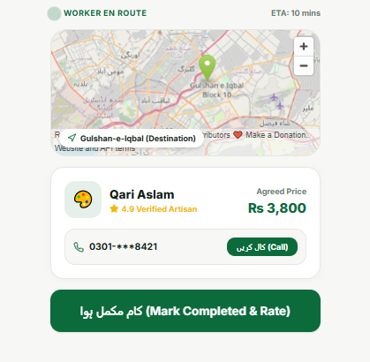 | 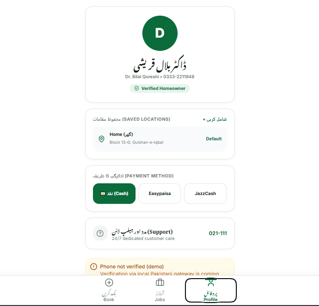 |

### Worker Portal & Live Radar
| Overview | Radar / Active | Job Match | Completion |
|:---:|:---:|:---:|:---:|
| 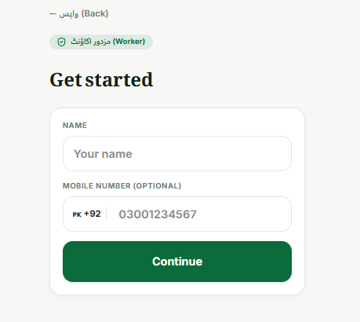 | 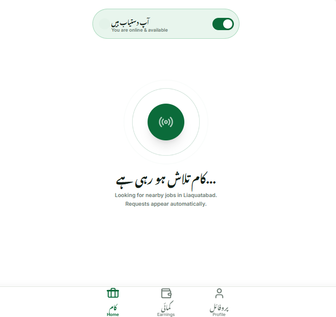 | 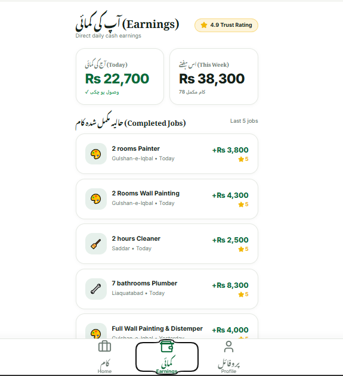 | 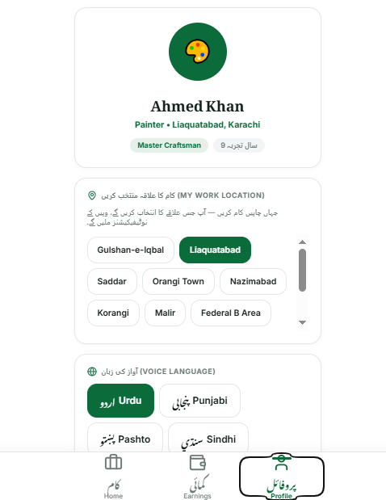 |

---
